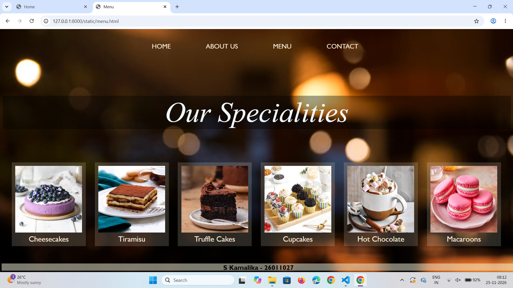
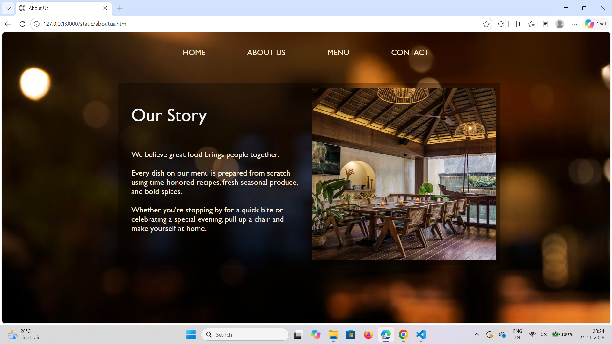
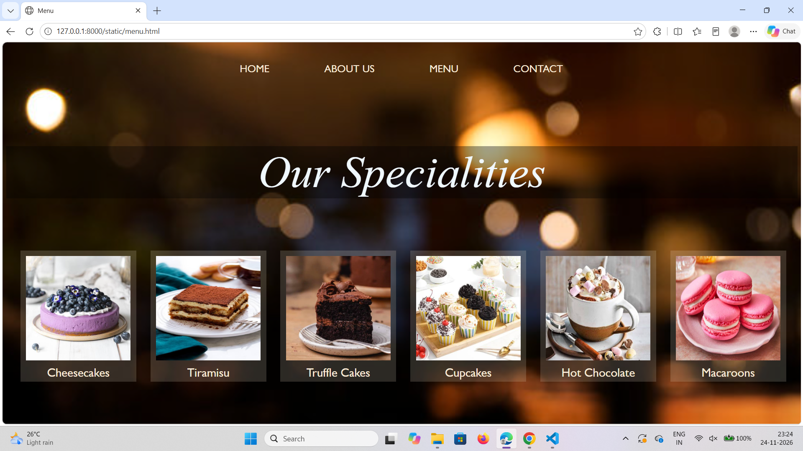
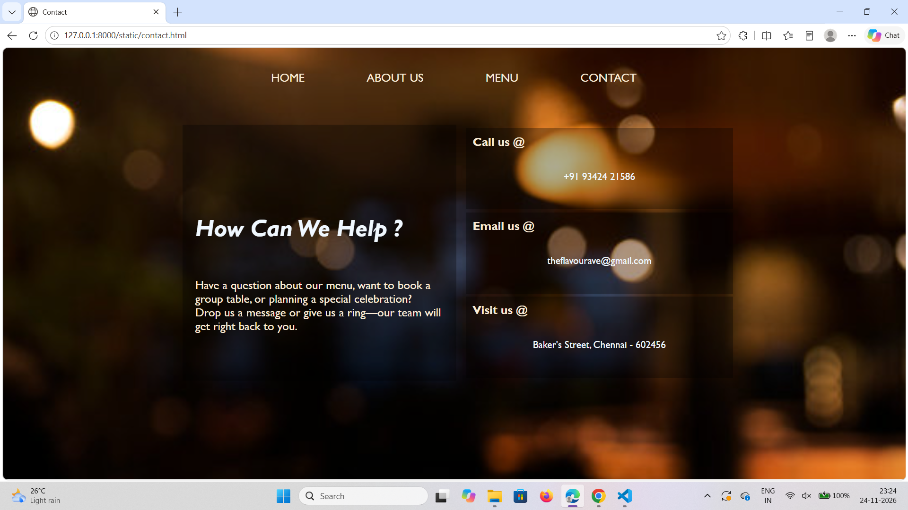
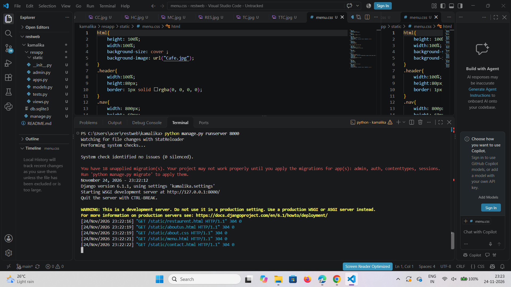

# Ex.06 Complex Problem: Restaurant Website
## Date: 24-11-2026

## AIM:
To develop a static Restaurant website to display the food items and services provided by them.

## DESIGN STEPS:

### Step 1:
Requirement collection.

### Step 2:
Creating the layout using HTML and CSS.

### Step 3:
Updating the sample content.

### Step 4:
Choose the appropriate style and color scheme.

### Step 5:
Validate the layout in various browsers.

### Step 6:
Validate the HTML code.

### Step 7:
Publish the website in Localhost.

## PROGRAM:

restaurent.html
```
<html>
<head>
    <link href="style.css" rel="stylesheet">
    <title>Home</title>
</head>
<body>
    <div class="header">
        <div class="nav">
            <a href="restaurent.html">HOME</a> 
            <a href="aboutus.html">ABOUT US</a> 
            <a href="menu.html">MENU</a> 
            <a href="contact.html">CONTACT</a> 
        </div>
    </div>
    <div class="shopname">Flavour Avenue</div>
    <div class="littlecontent">
        <div><h2>Crafted With Passion,Served With Warmth</h2></div>
        <div>Experience authentic flavours made from locally sourced ingredients, right in the heart of the city</div>
        
    </div>
    <div class="orderlink"><a href="menu.html">ORDER NOW</a></div>

    <div class="footer">
    </div>
</body>
</html>
```
style.css
```
html{
    width:100%;
    height:100%;
    background-image: url("Cafe.jpg");
    background-size: cover ;
}
.header{
    width:100%;
    height:80px;
    border: 1px solid rgba(0, 0, 0, 0);
    
}
.nav{
    width: 800px;
    height: 60px;
    border: 1px solid rgba(0, 0, 0, 0);
    margin-top: 10px;
    margin-left: 360px;
    font-family: 'Gill Sans', 'Gill Sans MT', Calibri, 'Trebuchet MS', sans-serif;
    display: flex;
}
.nav a{
    margin:20px;
    font-size: 20px;
    margin-left: 85px;
    text-decoration: none;
    color: antiquewhite;

}
.shopname{
    width:100%;
    border: 1px solid rgba(0, 0, 0, 0);
    text-align: center;
    font-family: 'Gill Sans', 'Gill Sans MT', Calibri, 'Trebuchet MS', sans-serif;
    font-weight: 700;
    font-size: 85px;
    margin-top: 130px;
    background-color: rgba(0, 0, 0, 0.366);
    color: aliceblue;

}
.littlecontent{
    width:100%;
    height:100px;
    border: 1px solid rgba(0, 0, 0, 0);
    text-align: center;
    font-size: 25px;
    background-color: rgba(0, 0, 0, 0.366);
    color: antiquewhite;
}
.orderlink{
    margin-top: 100px;
    text-align: center;
    font-size: 35px;
    font-family: 'Gill Sans', 'Gill Sans MT', Calibri, 'Trebuchet MS', sans-serif;
    border: 1px rgba(0, 0, 0, 0) solid;
    width:250px;
    margin-left: 635px;
    
}
.orderlink a{
    text-decoration: none;
    color: antiquewhite;
}
.footer{
    
    width:100%;
    height:80px;
    border: 1px solid rgba(0, 0, 0, 0);
    position: fixed;
    bottom: 0;
    left: 0;
}
```
aboutus.html
```
<html>
<head>
    <link rel="stylesheet" href="about.css">
    <title>About Us</title>
</head>
<body>
     <div class="header">
        <div class="nav">
            <a href="restaurent.html">HOME</a> 
            <a href="aboutus.html">ABOUT US</a> 
            <a href="menu.html">MENU</a> 
            <a href="contact.html">CONTACT</a> 
        </div>
    </div>
    <div class="mainbox">
        <div class="box1">
            <div class="title">Our Story</div>
            <div class="content">We believe great food brings people together. <br><br>
                Every dish on our menu is prepared from scratch using time-honored recipes, fresh seasonal produce, and bold spices.<br><br>
                Whether you're stopping by for a quick bite or celebrating a special evening, pull up a chair and make yourself at home.</div>
        </div>
        <div class="box2">
            
        </div>
    </div>
</body>
</html>
```
aboutus.css
```
html{
    width:100%;
    height:100%;
    background-image: url("Cafe.jpg"); 
    background-size: cover ;
}
.header{
    width:100%;
    height:80px;
    border: 1px solid rgba(0, 0, 0, 0);
    
}
.nav{
    width: 800px;
    height: 60px;
    border: 1px solid rgba(0, 0, 0, 0);
    margin-top: 10px;
    margin-left: 360px;
    font-family: 'Gill Sans', 'Gill Sans MT', Calibri, 'Trebuchet MS', sans-serif;
    display: flex;
}
.nav a{
    margin:20px;
    font-size: 20px;
    margin-left: 85px;
    text-decoration: none;
    color: antiquewhite;

}
.mainbox{
    border: 1px rgba(0, 0, 0, 0) solid;
    height: 454px;
    width: 956px;
    margin-top: 40px;
    margin-left: 285px;
    display: flex;
    background-color: rgba(0, 0, 0, 0.321);
}
.box1,.box2{
    border: 1px rgba(0, 0, 0, 0) solid;
    height: 432px;
    width: 462px;
    margin-left: 10px;
    margin-top: 10px;
}
.title{
    border: 1px rgba(0, 0, 0, 0) solid;
    text-align: left;
    padding: 20px;
    font-size: 45px;
    font-family: 'Gill Sans', 'Gill Sans MT', Calibri, 'Trebuchet MS', sans-serif;
    margin-top: 20px;
    color: aliceblue;
}
.content{
    border: 1px rgba(0, 0, 0, 0) solid;
    padding: 20px;
    margin-top: 20px;
    font-family: 'Gill Sans', 'Gill Sans MT', Calibri, 'Trebuchet MS', sans-serif;
    font-size: 20px;
    color: antiquewhite;
}
.box2 img{
    height:432px;
    width: 462px;
}
```
menu.html
```
<html>
<head>
    <link rel="stylesheet" href="menu.css">
    <title>Menu</title>
</head>
<body>
    <div class="header">
        <div class="nav">
        <a href="restaurent.html">HOME</a>
        <a href="aboutus.html">ABOUT US</a>
        <a href="menu.html">MENU</a>
        <a href="contact.html">CONTACT</a>
        </div>
    </div>
    <div class="title"> <i>Our Specialities</i></div>

  <div class="items">

     <div class="item1">
        <div class="img1">
            
        </div>
        <div class="name">Cheesecakes</div>
     </div>  

   <div class="item2">        
    <div class="img1">
        
    </div>
    <div class="name">Tiramisu</div>
</div> 

   <div class="item3">        
    <div class="img1">
        
    </div>
    <div class="name">Truffle Cakes</div>
</div>

   <div class="item4">        
    <div class="img1">
        
    </div>
    <div class="name">Cupcakes</div>
</div> 

   <div class="item5">        
    <div class="img1">
        
    </div>
    <div class="name">Hot Chocolate</div>
</div> 

   <div class="item6"> 
    <div class="img1">
        
    </div>
    <div class="name">Macaroons</div>
</div>

  </div>
</body>
</html>
```
menu.css
```
html{
    height: 100%;
    width:100%;
    background-size: cover ;
    background-image: url("Cafe.jpg");
}
.header{
    width:100%;
    height:80px;
    border: 1px solid rgba(0, 0, 0, 0);
}
.nav{
    width: 800px;
    height: 60px;
    border: 1px solid rgba(0, 0, 0, 0);
    margin-top: 10px;
    margin-left: 360px;
    font-family: 'Gill Sans', 'Gill Sans MT', Calibri, 'Trebuchet MS', sans-serif;
    display: flex;
}
.nav a{
    margin:20px;
    font-size: 20px;
    margin-left: 85px;
    text-decoration: none;
    color: antiquewhite;

}
.item1,.item2,.item3,.item4,.item5,.item6{

    height: 250px;
    width: 220px;
    border: 1px rgba(0, 0, 0, 0) solid;
    margin-left: 27px;
    background-color: rgba(250, 235, 215, 0.167);

}
.items{
    height: 100px;
    width:1500px;
    margin-top: 100px;
    
    display: flex;
}
.title{
    width:100%;
    border: 1px solid rgba(0, 0, 0, 0);
    text-align: center;
    font-family:system-ui, -apple-system, BlinkMacSystemFont, 'Segoe UI', Roboto, Oxygen, Ubuntu, Cantarell, 'Open Sans', 'Helvetica Neue', sans-serif cursive;
    font-weight: 300;
    font-size: 85px;
    margin-top: 110px;
    background-color: rgba(0, 0, 0, 0.366);
    color: aliceblue;
}

.img1 img{
    height: 200px;
    width: 200px;
    margin-top:10px;
    margin-left: 10px;
    margin-right: 10px;
}
.name{
    border: 1px rgba(0, 0, 0, 0) solid;
    height: 20px;
    margin-top:5px;
    text-align: center;
    font-size: 23px;
    color: antiquewhite;
    font-family: 'Gill Sans', 'Gill Sans MT', Calibri, 'Trebuchet MS', sans-serif;

}
```
contact.html
```
<html>
<head>
    <link rel="stylesheet" href="contact.css">
    <title>Contact</title>
</head>
<body>
    <div class="header">
        <div class="nav">
        <a href="restaurent.html">HOME</a>
        <a href="aboutus.html">ABOUT US</a>
        <a href="menu.html">MENU</a>
        <a href="contact.html">CONTACT</a>
    </div>
    <div class="mainbox">
        <div class="box1">
            <div class="title"><i><b>How Can We Help ?</b> </i></div>
            <div class="content">Have a question about our menu, want to book a group table, or planning a special celebration?<br> Drop us a message or give us a ring—our team will get right back to you.</div>
        </div>
        <div class="box2">
            <div class="detail">
                <div class="head2"><b>Call us @</b></div>
                <div class="content2">+91 93424 21586</div>
            </div>
            <div class="detail">
                <div class="head2"><b>Email us @</b></div>
                <div class="content2">theflavourave@gmail.com</div>
            </div>
            <div class="detail">
                <div class="head2"><b>Visit us @</b></div>
                <div class="content2">Baker's Street, Chennai - 602456</div>
            </div>
        </div>
    </div>

</body>
</html>
```
contact.css
```
html{
    height: 100%;
    width:100%;
    background-size: cover ;
    background-image: url("Cafe.jpg"); 
}
.header{
    width:100%;
    height:80px;
    border: 1px solid rgba(0, 0, 0, 0);
}
.nav{
    width: 800px;
    height: 60px;
    border: 1px solid rgba(0, 0, 0, 0);
    margin-top: 10px;
    margin-left: 360px;
    font-family: 'Gill Sans', 'Gill Sans MT', Calibri, 'Trebuchet MS', sans-serif;
    display: flex;
}
.nav a{
    margin:20px;
    font-size: 20px;
    margin-left: 85px;
    text-decoration: none;
    color: antiquewhite;
}
.mainbox{
    border: 1px rgba(0, 0, 0, 0) solid;
    height: 454px;
    width: 952px;
    margin-top: 40px;
    margin-left: 285px;
    display: flex;
}
.box1,.box2{
    border: 1px rgba(0, 0, 0, 0) solid;
    height: 432px;
    width: 462px;
    margin-left: 10px;
    margin-top: 10px;
}
.box1{
    background-color: rgba(0, 0, 0, 0.321);
}
.box2{
    display: flex;
    flex-direction: column;
}
.detail{
    border: 1px rgba(0, 0, 0, 0) solid;
    height: 136px;
    width: 450px;
    margin-top: 5px;
    margin-left: 5px;
    background-color: rgba(0, 0, 0, 0.321);

}
.title{
    border: 1px rgba(0, 0, 0, 0) solid;
    text-align: left;
    padding: 20px;
    font-size: 40px;
    font-family: 'Gill Sans', 'Gill Sans MT', Calibri, 'Trebuchet MS', sans-serif;
    margin-top: 130px;
    color: aliceblue;
}
.content{
    border: 1px rgba(0, 0, 0, 0) solid;
    padding: 20px;
    margin-top: 20px;
    font-family: 'Gill Sans', 'Gill Sans MT', Calibri, 'Trebuchet MS', sans-serif;
    font-size: 20px;
    color: antiquewhite;
}
.head2{
    border: 1px rgba(0, 0, 0, 0) solid;
    text-align: left;
    padding: 10px;
    font-size: 20px;
    font-family: 'Gill Sans', 'Gill Sans MT', Calibri, 'Trebuchet MS', sans-serif;
    color:antiquewhite;
}
.content2{
    border: 1px rgba(0, 0, 0, 0) solid;
    text-align: center;
    margin-top: 15px;
    padding: 10px;
    font-size: 17px;
    font-family: 'Gill Sans', 'Gill Sans MT', Calibri, 'Trebuchet MS', sans-serif;
    color: aliceblue;
}
```

## OUTPUT:
Web Page:




Server Side:


## RESULT:
The program for designing software company website using HTML and CSS is completed successfully.
